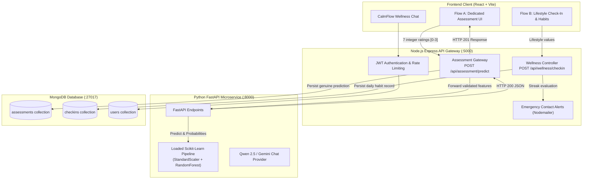

# 🧠 MindMate — AI-Driven Student Stress Prediction & Mental Wellness Platform

[](https://react.dev/)
[](https://fastapi.tiangolo.com/)
[](https://expressjs.com/)
[](https://scikit-learn.org/)
[](https://www.mongodb.com/)
[](https://www.docker.com/)

---

## 📌 Executive Summary

**MindMate** is a multi-tier academic wellness and student stress prediction application designed for university students. The platform provides:
1. **Flow A (Machine Learning Assessment)**: A dedicated 7-feature questionnaire stress pattern classifier backed by a trained Scikit-Learn Random Forest Pipeline served via FastAPI.
2. **Flow B (Daily Lifestyle Check-In)**: An independent habit tracker (sleep, study hours, screen exposure, exam proximity, mood, notes) using a transparent rule-based lifestyle index.
3. **Conversational Support Companion**: "CalmFlow", a supportive wellness chatbot with grounding exercises and crisis boundary protection.
4. **Emergency Escalation System**: Automated email alerts to trusted contacts during prolonged high-stress periods and one-tap emergency SOS support.

---

## 🏛️ System Architecture



---

## 🔬 Machine Learning Pipeline & Verified Metrics

### 1. Dataset Provenance & Formulation
* **Dataset**: Synthetic student stress survey dataset (`student_stress_dataset.csv`, 16,384 total samples, representing the full-factorial $4^7$ space of 7 features with 4 response levels).
* **Feature Schema**:
  1. `Nervousness`: Rating (0: No, 1: Mild, 2: Moderate, 3: Severe)
  2. `Unable to Control`: Rating (0: No, 1: Mild, 2: Moderate, 3: Severe)
  3. `Worry`: Rating (0: No, 1: Mild, 2: Moderate, 3: Severe)
  4. `Trouble in Relaxation`: Rating (0: No, 1: Mild, 2: Moderate, 3: Severe)
  5. `Restlessness`: Rating (0: No, 1: Mild, 2: Moderate, 3: Severe)
  6. `Irritability`: Rating (0: No, 1: Mild, 2: Moderate, 3: Severe)
  7. `Fear`: Rating (0: No, 1: Mild, 2: Moderate, 3: Severe)
* **Target Classes**: `No` (0), `Mild` (1), `Moderate` (2), `Severe` (3).

### 2. Leak-Free Model Training
* Preprocessing: `StandardScaler` fitted **strictly on training data** within an integrated `sklearn.pipeline.Pipeline`.
* Classifier: `RandomForestClassifier(n_estimators=120, max_depth=10, random_state=42)`.
* Artifact: Serialized pipeline saved at `ai-service/models/student_stress_pipeline.joblib`.

### 3. Verified Holdout Evaluation Metrics (80/20 Split, 3,277 Test Samples)

| Stress Tier | Precision | Recall | F1-Score | Support |
| :--- | :---: | :---: | :---: | :---: |
| **No** | 0.46 | 0.74 | 0.56 | 65 |
| **Mild** | 0.90 | 0.88 | 0.89 | 1,574 |
| **Moderate** | 0.89 | 0.83 | 0.86 | 1,491 |
| **Severe** | 0.49 | 0.78 | 0.60 | 147 |
| **Overall Accuracy** | — | — | **85.11%** | 3,277 |
| **Weighted Average** | **0.87** | **0.85** | **0.86** | 3,277 |

---

## 🌟 Key Application Features

1. **Flow A — ML Questionnaire Stress Assessment**:
   * Dedicated assessment interface with strict ordinal inputs (0 to 3).
   * Validated gateway forwarding to FastAPI with live probability distribution.
   * Explicit educational disclaimer: *not a psychiatric or clinical diagnosis*.
   * Isolated assessment history sorted newest-first with cross-user ownership isolation.
2. **Flow B — Daily Lifestyle Habit Check-In**:
   * Independent tracking for sleep, study hours, screen exposure, and exam proximity.
   * Transparent rule-based lifestyle index without claiming machine learning.
   * Saves to separate MongoDB `checkins` collection without contaminating ML assessment records.
3. **Personalized Wellness Recommendations**:
   * 2-minute visual breathing pacer, 10-minute walk reminders, 20-20-20 screen rests, and Pomodoro focus blocks.
4. **CalmFlow AI Wellness Companion**:
   * Empathetic chat support with multi-tier routing (FastAPI / Gemini / Rule-based CalmFlow fallback).
   * Strict crisis guardrails with verified hotlines (Tele-MANAS, KIRAN, 988 Lifeline).
5. **Emergency Contacts & Watchdog Alerts**:
   * One-tap manual SOS dispatch via email.
   * Automated watchdog notifications triggered when persistent high stress is detected.

---

## 🚀 Getting Started & Local Setup

### Prerequisites
* **Node.js**: v20 or higher
* **Python**: v3.11 or higher
* **MongoDB**: v6.0 or higher (local daemon or free MongoDB Atlas cluster)
* **Docker & Docker Compose** *(optional for containerized execution)*

---

### Option A: 1-Command Startup via Docker Compose

```bash
docker compose up --build
```

Services will be accessible at:
* **Frontend Portal**: [http://localhost:3000](http://localhost:3000)
* **Backend API Gateway**: [http://localhost:5000](http://localhost:5000)
* **FastAPI AI Microservice**: [http://localhost:8000/docs](http://localhost:8000/docs)
* **MongoDB**: `localhost:27017`

---

### Option B: Local Multi-Process Startup

#### 1. Python AI Service
```bash
cd ai-service
python3 -m venv .venv
source .venv/bin/activate
pip install -r requirements.txt
uvicorn app.main:app --host 127.0.0.1 --port 8000 --reload
```

#### 2. Node.js Backend Gateway
```bash
cd server
npm install
npm start
```

#### 3. React Frontend Client
```bash
cd client
npm install
npm run dev
```
Open [http://localhost:5173](http://localhost:5173) in your browser.

---

## ⚙️ Environment Variables Checklist

Copy the `.env.example` templates to `.env` in their respective directories:

### `server/.env` (Backend API Gateway)
| Variable | Description | Example / Default |
| :--- | :--- | :--- |
| `PORT` | Listening port for Express gateway | `5000` |
| `NODE_ENV` | Environment mode (`development` or `production`) | `production` |
| `MONGO_URI` | MongoDB connection URI (**Required in production**) | `mongodb://localhost:27017/mindmate` |
| `JWT_SECRET` | Secret key for signing JWT tokens (**Required in production**) | Long random secret string |
| `JWT_EXPIRES_IN` | Token validity duration | `7d` |
| `FASTAPI_SERVICE_URL` | Microservice URL for questionnaire ML predictions | `http://localhost:8000` |
| `CORS_ORIGIN` | Comma-separated allowed origins in production | `https://your-frontend.vercel.app` |
| `GEMINI_API_KEY` | Optional Google Gemini key for direct CalmFlow chat | `AIza...` |
| `SMTP_HOST` | SMTP server host for emergency alerts | `smtp.gmail.com` |
| `SMTP_PORT` | SMTP port | `587` |
| `SMTP_USER` | SMTP username/email | `your_email@gmail.com` |
| `SMTP_PASS` | SMTP application password | `app_password` |

### `ai-service/.env` (FastAPI Microservice)
| Variable | Description | Example / Default |
| :--- | :--- | :--- |
| `PORT` | Listening port for FastAPI | `8000` |
| `AI_PROVIDER` | AI provider for chatbot (`groq`, `gemini`, etc.) | `groq` |
| `AI_API_KEY` | API key for AI provider | `gsk_...` |
| `ALLOWED_ORIGINS` | Comma-separated CORS allowed origins | `http://localhost:5000,http://127.0.0.1:5000` |

### `client/.env` (React Vite)
| Variable | Description | Example / Default |
| :--- | :--- | :--- |
| `VITE_API_BASE_URL` | Base URL for API gateway requests | `http://localhost:5000/api` (or `/api` if unified) |

---

## 🧪 Testing & Verification Suites

MindMate includes comprehensive automated test suites covering all tiers:

```bash
# 1. AI Service Tests (ML pipeline, validation, 503 handling)
cd ai-service && .venv/bin/pytest tests/

# 2. Backend Gateway Tests (Validation, auth, isolation, live e2e chain)
cd server && npm test

# 3. Frontend Client Tests (API contract, ratings, disclaimers)
cd client && npm test

# 4. Frontend Production Build Check
cd client && npm run build
```

---

## ⚠️ Known Limitations & Ethical Boundaries

1. **Synthetic Training Dataset**:
   The model was trained on `student_stress_dataset.csv`, a synthetic full-factorial permutation dataset ($4^7 = 16,384$ rows). While mathematically sound for pattern classification, **it does not constitute clinical epidemiology**.
2. **Non-Diagnostic Disclaimer**:
   MindMate is strictly an educational self-reflection and habit-tracking tool. It **does not provide medical, psychiatric, or clinical diagnosis**.
3. **Model Resilience**:
   If the ML service or model pipeline artifact is offline, the gateway returns a clean **HTTP 503 Service Unavailable** error rather than fabricating fake stress classifications.
